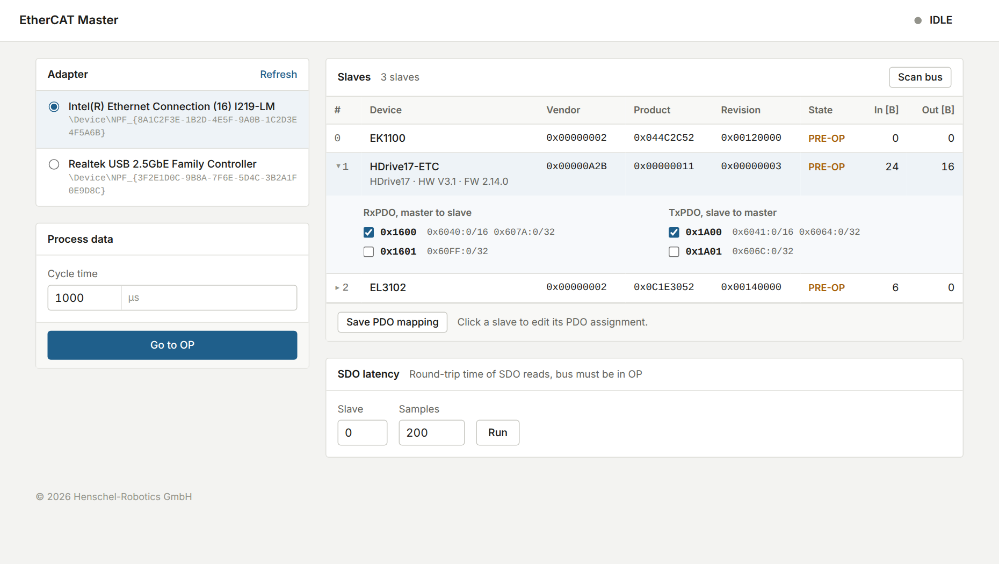
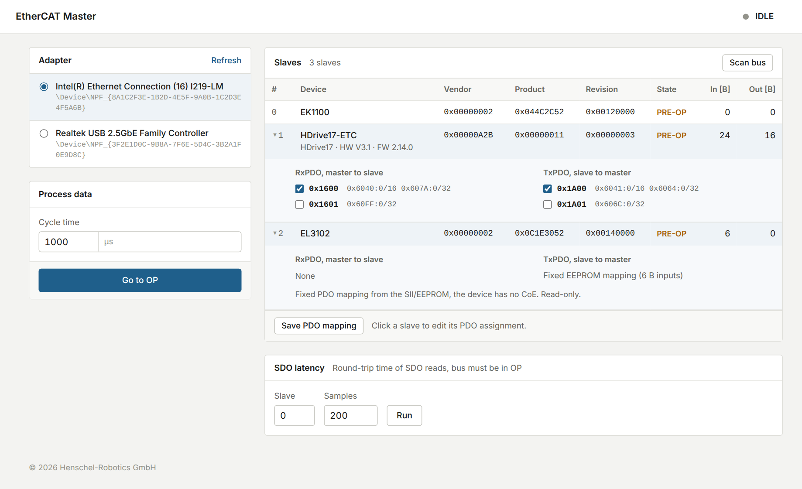
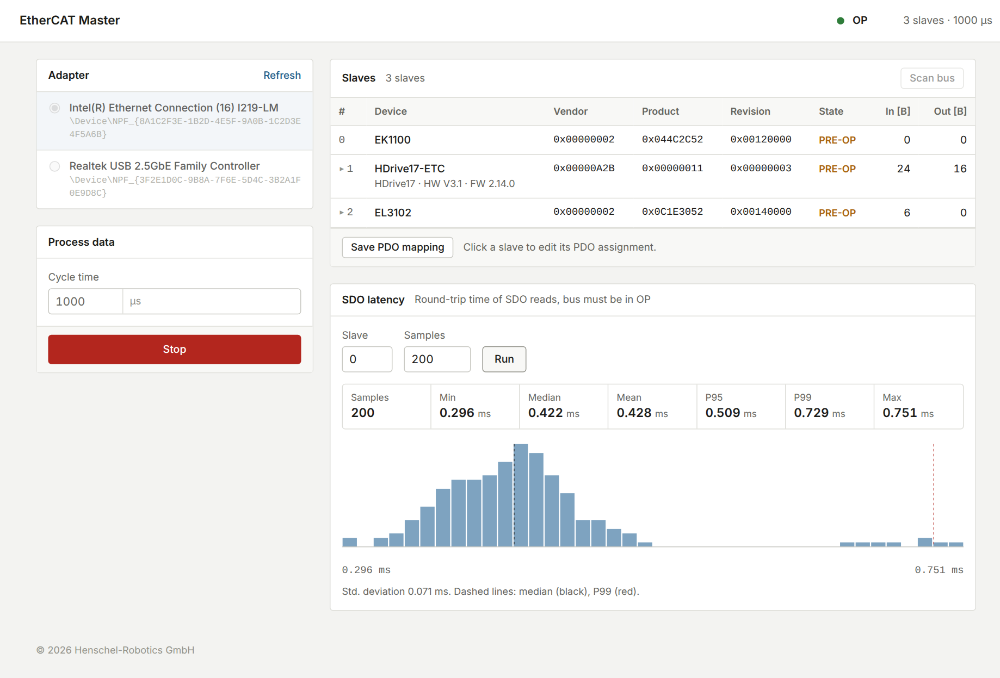

# EtherCAT Master

Generic EtherCAT master library built directly on [SOEM 2.x](https://github.com/OpenEtherCATsociety/SOEM) (bundled C shim, loaded via ctypes; no PySOEM needed). Provides bus management, slave discovery, configurable PDO mapping, automatic reconnection, and a built-in web interface for configuration.

Developed by [Henschel Robotics GmbH](https://henschel-robotics.ch).



## Features

- **Bus management** -- connect, configure, and run an EtherCAT bus with one or more slaves
- **Generic slave handle** -- read/write raw PDO bytes for any device (Beckhoff terminals, servos, I/O modules, ...)
- **PDO mapping** -- configure SyncManager assignments per slave via a JSON file or SDO writes
- **Bus discovery** -- scan the bus and detect any EtherCAT device (Beckhoff, Henschel, or any other vendor)
- **Auto-reconnect** -- background health monitoring with automatic recovery on cable disconnect
- **Web interface** -- built-in browser GUI for adapter selection, bus scanning, PDO configuration, and going OP
- **Extensible** -- subclass `GenericSlave` or implement the slave handle interface to build device-specific drivers (see [python-hdrive-etc](https://github.com/henschel-robotics/python-hdrive-etc))

## Prerequisites

### Windows

| Dependency | Purpose | License |
|---|---|---|
| [Npcap](https://npcap.com/) | Raw Ethernet packet capture | **Free for personal use** (up to 5 systems). Commercial / redistribution requires an [Npcap OEM license](https://npcap.com/oem/). |

Install Npcap with **WinPcap API-compatible mode** enabled (checkbox during setup).

### Linux

| Dependency | Purpose | License |
|---|---|---|
| `libpcap` | Raw Ethernet packet capture | BSD (free for any use) |

Install via your package manager:

```bash
# Debian / Ubuntu
sudo apt install libpcap-dev

# Fedora / RHEL
sudo dnf install libpcap-devel
```

On Linux, raw Ethernet access requires **root**. Either run with `sudo` or grant the capability once:

```bash
# Option A – run with sudo
sudo pip install ethercat-master --break-system-packages
sudo ecmaster-web

# Option B – grant raw socket capability (no sudo needed afterwards)
sudo setcap cap_net_raw=ep $(readlink -f $(which python3))
```

> Npcap is **not** needed on Linux -- `libpcap` provides the same functionality and is BSD-licensed.

### Raspberry Pi Quick-Start

```bash
# 1. Install libpcap
sudo apt update
sudo apt install libpcap-dev

# 2. Install ethercat-master system-wide (so sudo can find it)
sudo pip install ethercat-master --break-system-packages

# 3. Add ~/.local/bin to PATH (if not already)
echo 'export PATH="$HOME/.local/bin:$PATH"' >> ~/.bashrc
source ~/.bashrc

# 4. Launch the web interface (requires root for raw Ethernet)
sudo ecmaster-web --adapter eth0
```

Open `http://<pi-ip>:8080` from any device on your network.

> Connect the EtherCAT slave(s) directly to the Pi's Ethernet port (`eth0`).
> Use Wi-Fi or a second USB-Ethernet adapter for SSH / network access.

### Python

- **Python 3.8+**
- **SOEM 2.0.1** -- vendored in `third_party/SOEM` and compiled into `ethercat_master/libecm` (`.so`/`.dll`) at build time
- Building from source needs **CMake >= 3.16** and a C compiler (GCC/Clang, MSVC or MinGW-w64)
- Optional legacy backend: `pip install ethercat-master[pysoem]` and set `ETHERCAT_MASTER_BACKEND=pysoem`

### Building from source

```bash
pip install build
python -m build --wheel          # builds SOEM + libecm via scikit-build-core
```

## Installation

```bash
pip install ethercat-master
```

Or install from source:

```bash
git clone https://github.com/henschel-robotics/python-ethercat-master.git
cd python-ethercat-master
pip install -e .
```

## Quickstart

### 1. Find your network adapter

```python
from ethercat_master import EtherCATBus

for a in EtherCATBus.list_adapters():
    print(f"{a.desc}  ->  {a.name}")
```

Copy the adapter `name` (e.g. `\Device\NPF_{GUID}` on Windows, `eth0` on Linux).

### 2. Connect and read PDO data

```python
from ethercat_master import EtherCATBus, GenericSlave
import time

bus = EtherCATBus(adapter=r"\Device\NPF_{...}", cycle_time_ms=1)

slave = GenericSlave(0)
bus.register_slave(slave)
bus.open()

# Read inputs
print(slave.input.hex())

# Write outputs
slave.output = bytes([0xFF])

time.sleep(2)
bus.close()
```

### 3. Discover slaves on the bus

```python
slaves = EtherCATBus.discover(adapter=r"\Device\NPF_{...}")
for s in slaves:
    print(f"[{s['index']}] {s['device_name']}  "
          f"In={s['input_bytes']}B  Out={s['output_bytes']}B")
```

## PDO Configuration

Create a `ethercat_config.json` to control the network adapter, real-time
behaviour, and which PDOs are assigned per slave:

```json
{
  "network": {
    "adapter": "\\Device\\NPF_{...}",
    "cycle_ms": 1.0,
    "processdata_cycle_ms": 1.0,
    "timing_policy": "precise",
    "high_priority": true
  },
  "default": {},
  "slaves": {
    "0": {
      "rx_pdo": ["0x1600", "0x1605"],
      "tx_pdo": ["0x1A00", "0x1A05"]
    }
  }
}
```

- `cycle_ms`: PDO update cycle time in milliseconds.
- `processdata_cycle_ms`: Raw EtherCAT send/receive cycle in milliseconds.
  Defaults to `1.0` when omitted. Set this to the desired bus frequency
  independently of `cycle_ms`.
- `timing_policy`: One of `precise` (busy-yield, lowest jitter), `balanced`
  (sleep then yield, lower CPU), or `low_cpu` (sleep only, highest jitter).
- `high_priority`: Raise process/thread priority at bus start to reduce
  scheduler jitter. Use with caution; may starve other threads.

Pass it when creating the bus:

```python
bus = EtherCATBus(adapter=..., cycle_time_ms=1, pdo_config_path="ethercat_config.json")
```

Or use the web interface to scan the bus, select PDOs with checkboxes, and save.

> **Raspberry Pi / Linux:** When installed via pip, the default `ethercat_config.json` is inside the package directory (e.g. `/usr/local/lib/python3.13/dist-packages/ethercat_master/ethercat_config.json`). Copy it to your working directory for easy editing:
>
> ```bash
> cp $(python3 -c "import ethercat_master, os; print(os.path.join(os.path.dirname(ethercat_master.__file__), 'ethercat_config.json'))") .
> ```

## Web Interface

Start the built-in web server using the **console script** (after `pip install ethercat-master`):

```bash
sudo ecmaster-web
sudo ecmaster-web --port 8080
sudo ecmaster-web --pdo-config /path/to/ethercat_config.json
```

Or run the same entry point as a **module** (useful in venvs, CI, or when `ecmaster-web` is not on `PATH`):

```bash
sudo python -m ethercat_master.webserver
sudo python -m ethercat_master.webserver --port 8080
sudo python -m ethercat_master.webserver --pdo-config /path/to/ethercat_config.json
```

On **Windows**, omit `sudo` (Npcap provides raw Ethernet access for the current user).

Then open `http://localhost:8080` in your browser.

The web GUI lets you:

- Select a network adapter
- Scan the bus and discover **any EtherCAT device** — Beckhoff terminals, IO modules, servo drives, and more
- Configure PDO assignments per slave
- Set the cycle time and go to OP state
- Measure SDO round-trip latency (statistics and histogram)

| Mixed bus (Beckhoff + HDrive) | SDO latency in OP |
|---|---|
|  |  |

> **Full guide:** [`docs/web-interface.md`](docs/web-interface.md)

## Project Structure

```
python-ethercat-master/
├── ethercat_master/
│   ├── __init__.py          # Public API
│   ├── bus.py               # EtherCATBus — core bus management
│   ├── slave.py             # GenericSlave — universal slave handle
│   ├── pdo.py               # PDO mapping configuration
│   ├── exceptions.py        # Custom exceptions
│   ├── webserver.py         # Built-in web server
│   └── webgui/
│       ├── index.html       # Web GUI frontend
│       └── style.css        # Stylesheet
├── examples/
│   ├── connect.py           # Minimal single-slave example
│   ├── beckhoff.py          # Beckhoff EK1100 + terminals
│   └── mixed_bus.py         # HDrive motor + Beckhoff terminals
├── ethercat_config.json         # Example PDO config
└── pyproject.toml
```

## Examples

The [`examples/`](examples/) folder contains ready-to-run scripts. The recommended workflow is:

1. **Configure the bus** using the web interface (`ecmaster-web`):
   - Select your network adapter
   - Click **Scan Bus** to discover all slaves
   - Expand each slave and configure the PDO assignments
   - Click **Save PDO Config** — this writes `ethercat_config.json` with the adapter, cycle time, and per-slave PDO mapping

2. **Copy `ethercat_config.json`** next to your script (or point to it with `pdo_config_path`)

3. **Run the example** — the bus uses the preconfigured adapter and PDO mapping from the file:

```bash
sudo python3 examples/connect.py          # Linux
python examples\connect.py                 # Windows
```

### `connect.py` — Minimal single-slave example

Connects to one slave and continuously prints the raw input PDO bytes. Good for verifying that the bus works and PDOs are mapped correctly.

### `beckhoff.py` — Beckhoff coupler + terminals

Scans the bus, discovers all terminals behind an EK1100 coupler, and reads their inputs in a loop. Standard Beckhoff terminals use factory-default PDO mappings from the SII EEPROM, so no `ethercat_config.json` is needed.

### `mixed_bus.py` — HDrive motor + Beckhoff terminals

Demonstrates running an HDrive servo motor alongside Beckhoff I/O terminals on the same bus. Requires `pip install hdrive-etc`. The `HDriveETC` class is a slave handle that plugs into `EtherCATBus` just like `GenericSlave`, so you can combine any devices.

## API Overview

### `EtherCATBus`

| Method | Description |
|---|---|
| `EtherCATBus(adapter, cycle_time_ms, pdo_config_path)` | Create a bus instance |
| `list_adapters()` | List available network adapters |
| `discover(adapter, pdo_config_path)` | Scan the bus without going to OP |
| `register_slave(handle)` | Register a slave handle |
| `open()` | Configure slaves, map PDOs, start threads, go to OP |
| `close()` | Stop all slaves and close the connection |

### `GenericSlave`

| Property / Method | Description |
|---|---|
| `GenericSlave(slave_index, use_default_pdo)` | Create a handle for slave at the given index |
| `slave.input` | Read-only bytes of the last received input PDO |
| `slave.output` | Read/write bytes for the output PDO |

### Exceptions

| Exception | When |
|---|---|
| `ConnectionError` | Adapter not found, no slaves, state transition failed |
| `CommunicationError` | Bus communication lost or timed out |
| `ConfigurationError` | PDO mapping or `config_map()` failed |

## Background Threads

When `bus.open()` is called, three background threads are started:

| Thread | Interval | Purpose |
|---|---|---|
| ProcessData | 1 ms | Raw EtherCAT frame send/receive |
| PDO Update | configurable | Decode RX / encode TX per slave |
| State Check | 300 ms | Health monitoring, auto-reconnect |

## License

This project is licensed under the **GNU General Public License v3.0 or later** -- see [LICENSE](LICENSE). It statically links SOEM 2.x, which is GPLv3 (or commercial from rt-labs).

Copyright (c) Henschel Robotics GmbH

### Third-party license notice

| Component | License | Notes |
|---|---|---|
| [SOEM](https://github.com/OpenEtherCATsociety/SOEM) | **GPLv3 / Commercial** | v2.0.1 vendored in `third_party/SOEM`, statically linked into `libecm`. GPLv3 or a commercial license from [rt-labs](https://rt-labs.com/). |
| [Npcap](https://npcap.com/) (Windows only) | **Proprietary** | Free for personal use (≤ 5 installs). Commercial use or redistribution requires an [Npcap OEM license](https://npcap.com/oem/). |
| [libpcap](https://www.tcpdump.org/) (Linux only) | BSD | Free for any use, no restrictions. |

> **Important for commercial products:** If you ship a product that includes this library, you need to consider the SOEM (GPLv3) and Npcap (proprietary) license obligations. On Linux, only the SOEM license applies since libpcap is BSD.
